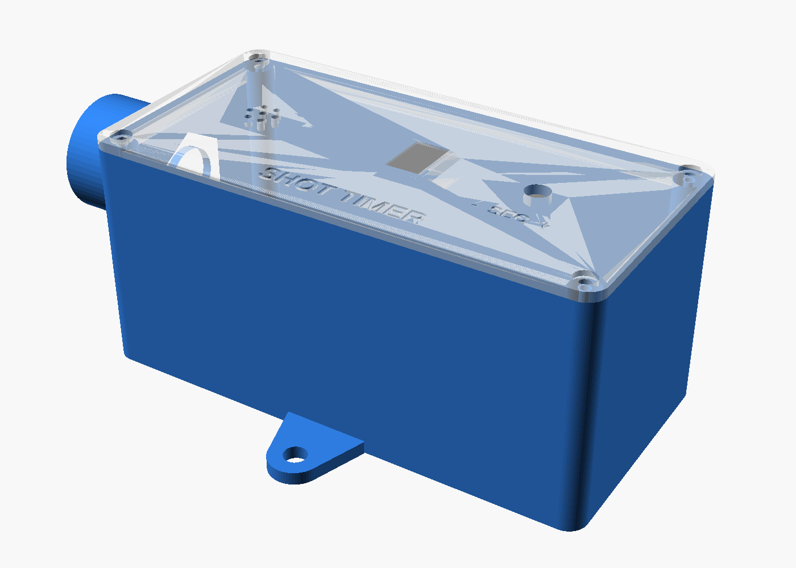

# Case

A 3D-printable case for the shot timer. It's parametric: change a few numbers in
[`case.scad`](case.scad) and export new STL files.




## Parts

| File | What | Print orientation |
|---|---|---|
| [`stl/box.stl`](stl/box.stl) | Bottom shell: sensor hole, 4 screw pillars, tent-peg tabs, drain holes | as exported (opening up) |
| [`stl/lid.stl`](stl/lid.stl) | Lid: display window, knob hole, buzzer holes, labels | as exported (**top face down** on the bed) |
| [`stl/hood.stl`](stl/hood.stl) | Sun shield for the sensor | as exported (standing up) |

**No supports needed** for any part.

Outside size: **158 × 78 × 74 mm** (124 mm wide across the tent-peg tabs).
That fits a 180 × 180 mm print bed.

## Before you print: measure your power bank

The box is sized around the power bank. The default is **100 × 65 × 23 mm**. Measure
yours, put the numbers in the first lines of `case.scad`, and export again:

```
powerbank = [100, 65, 23];   // length, width, height
```

The box grows or shrinks with it.

## Print settings

- **Material: PETG or ASA.** PLA goes soft in a car or in summer sun.
- Layer height 0.2 mm, 3 walls, 20 % infill.

## Also needed

| Item | For |
|---|---|
| 4× M3 × 12 mm screws (pan head, self-tapping or regular) | lid → box; they cut their own thread in the pillars |
| Hot glue | display, knob and buzzer under the lid |
| Velcro strip | power bank to the floor, breadboard on top of the power bank |
| 2 tent pegs | to fix the box on the grass |

## Putting it together

1. **Sensor:** screw one nut onto the sensor, push it through the front hole from the
   inside, slide the **hood** over it (flange against the wall), and tighten the second
   nut inside the hood. The sensor's LED and sensitivity screw stay inside the box.
2. **Power bank** on the floor behind the small ridge, with velcro. The ridge keeps it out
   of the sensor's space.
3. **Breadboard** on top of the power bank, with velcro.
4. **Lid, from below:**
   - **Display:** push it into the frame until it sits behind the window. Mount it so the
     digit reads the same way as the text on the lid. A drop of hot glue holds it.
   - **Knob:** push the shaft up through the hole and hot-glue the encoder board in place
     (this model has no thread for a nut).
   - **Buzzer:** glue it under the small hole pattern.
5. **Lid on**, 4 screws.

The front of the box (sensor side) faces the path the players dribble along. The sensor
sits 45 mm above the ground; change `sensor_z` if you want it higher.

## Optional

- **Switch in the back wall:** set `with_switch = true` for a cut-out that fits a KCD11
  mini rocker switch. You then have to wire the switch into the 5V line from the power
  bank, which means cutting a USB cable and soldering.

## Editing and exporting

Open `case.scad` in [OpenSCAD](https://openscad.org) (free). The preview shows the
assembled case with grey dummy parts. To export:

```bash
openscad -D 'part="box"'  -o stl/box.stl  case.scad
openscad -D 'part="lid"'  -o stl/lid.stl  case.scad
openscad -D 'part="hood"' -o stl/hood.stl case.scad
```

### Checking that everything fits

After changing sizes, these three must each say **"Current top level object is empty"**
(nothing overlaps):

```bash
openscad -D 'part="check_box"'    -o /tmp/check.stl case.scad
openscad -D 'part="check_lid"'    -o /tmp/check.stl case.scad
openscad -D 'part="check_inside"' -o /tmp/check.stl case.scad
```

The dummy parts use typical sizes (sensor, M18 nut, breadboard, encoder board, buzzer
module). If yours are bigger, adjust the `d_…` modules at the bottom of the file.
