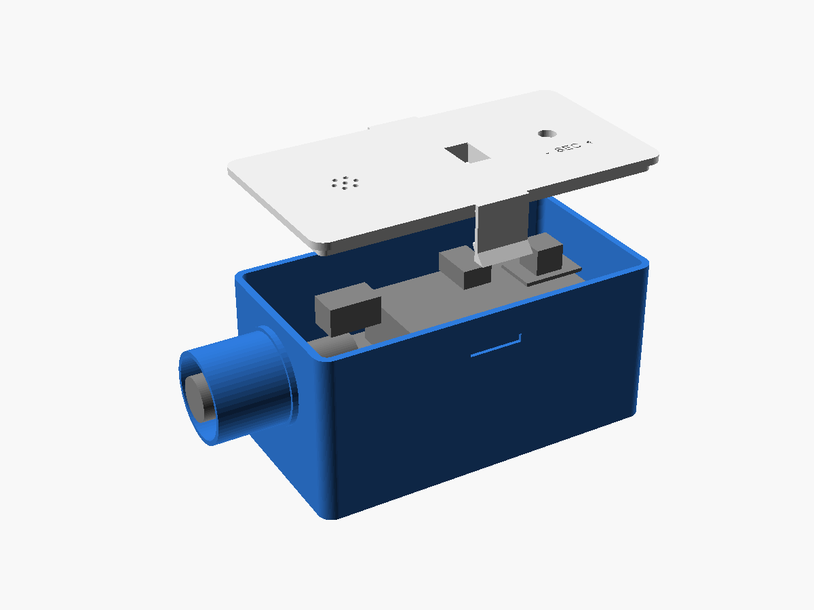
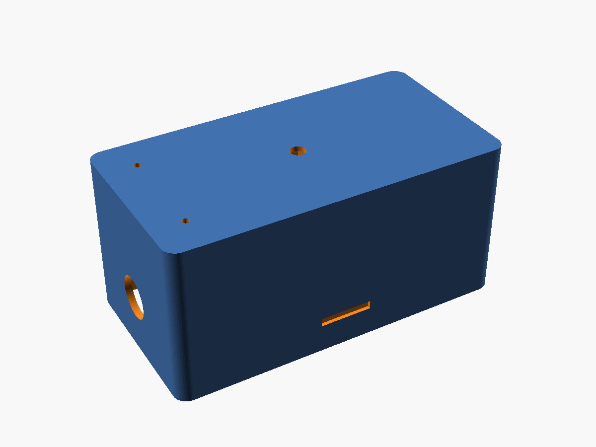

# Case

A 3D-printable case for the shot timer. It's parametric: change a few numbers in
[`case.scad`](case.scad) and export new STL files.





## Parts

| File | What | Print orientation |
|---|---|---|
| [`stl/box.stl`](stl/box.stl) | Bottom shell: sensor hole, clip pockets, tripod nut pocket, drain holes | as exported (opening up) |
| [`stl/lid.stl`](stl/lid.stl) | Lid with 2 snap clips: display window, knob hole, buzzer holes, "- SEC +" label | as exported (**top face down**, clips pointing up) |
| [`stl/hood.stl`](stl/hood.stl) | Sun shield for the sensor | as exported (standing up) |

**No supports needed** for any part.

Outside size: **150 × 78 × 74 mm**.
That fits a 180 × 180 mm print bed.

## Before you print: measure your power bank

The box is sized around the power bank. The default is **100 × 65 × 23 mm**. Measure
yours, put the numbers in the first lines of `case.scad`, and export again:

```
powerbank = [100, 65, 23];   // length, width, height
```

The box grows or shrinks with it.

## Print settings

- **Material: PETG or ASA.** PLA goes soft in a car or in summer sun.
- Layer height 0.2 mm, 3 walls, 20 % infill.

## Also needed

| Item | For |
|---|---|
| 1× **1/4"-20 hex nut** (UNC, 7/16" / 11 mm across flats) | tripod thread; hardware or photo shop, often sold as "1/4 inch statiefmoer" |
| Hot glue | display, knob and buzzer under the lid |
| Velcro strip | power bank to the floor, breadboard on top of the power bank |

## Putting it together

1. **Sensor:** screw one nut onto the sensor, push it through the front hole from the
   inside, slide the **hood** over it (flange against the wall), and tighten the second
   nut inside the hood. The sensor's LED and sensitivity screw stay inside the box.
2. **Tripod nut:** drop the 1/4" nut into the hexagon pocket in the middle of the floor.
3. **Power bank** on the two rails and the nut block, behind the ridge, with velcro. It
   covers the nut so the nut can't fall out. The ridge keeps it out of the sensor's space.
4. **Breadboard** on top of the power bank, with velcro.
5. **Lid, from below:**
   - **Display:** push it into the frame until it sits behind the window. Mount it so the
     digit reads the same way as the text on the lid. A drop of hot glue holds it.
   - **Knob:** push the shaft up through the hole and hot-glue the encoder board in place
     (this model has no thread for a nut).
   - **Buzzer:** glue it under the small hole pattern.
6. **Lid on:** press it down until both clips click.

## On a tripod

The bottom has a standard **1/4" camera thread** in the middle, so any phone tripod,
camera tripod or selfie stick fits. Take the phone clamp off the tripod and screw the
box on in its place.

The tripod screw comes up through the floor into the nut and pulls it down, so the
nut can't spin or come loose. Screws up to about 7.5 mm long fit (most are 5–6 mm);
a longer one would push against the power bank.

Turn the tripod head so the sensor points across the path the players dribble along.
Keep the tripod low: the sensor has to see the ball, so aim for **10–15 cm** above the
grass (the middle of a size-5 ball is about 11 cm up).

Don't need it? Set `tripod_mount = false`; the power bank then sits on the floor again.

## Opening the lid

No tools needed. Pull the **finger tabs** at the bottom of both clips (the middle of
each long side) outward and lift the lid.

Too stiff or too loose? Change `clip_t` (arm thickness, default 1.8 mm) or `clip_hook`
(how far the hook grips, default 1.2 mm) and print the lid again.

The front of the box (sensor side) faces the path the players dribble along. The sensor
sits 45 mm above the ground; change `sensor_z` if you want it higher.

## Optional

- **Switch in the back wall:** set `with_switch = true` for a cut-out that fits a KCD11
  mini rocker switch. You then have to wire the switch into the 5V line from the power
  bank, which means cutting a USB cable and soldering.

## Editing and exporting

Open `case.scad` in [OpenSCAD](https://openscad.org) (free). The preview shows the
assembled case with grey dummy parts. To export:

```bash
openscad -D 'part="box"'  -o stl/box.stl  case.scad
openscad -D 'part="lid"'  -o stl/lid.stl  case.scad
openscad -D 'part="hood"' -o stl/hood.stl case.scad
```

### Checking that everything fits

After changing sizes, these three must each say **"Current top level object is empty"**
(nothing overlaps):

```bash
openscad -D 'part="check_box"'    -o /tmp/check.stl case.scad
openscad -D 'part="check_lid"'    -o /tmp/check.stl case.scad
openscad -D 'part="check_inside"' -o /tmp/check.stl case.scad
```

The dummy parts use typical sizes (sensor, M18 nut, breadboard, encoder board, buzzer
module). If yours are bigger, adjust the `d_…` modules at the bottom of the file.
